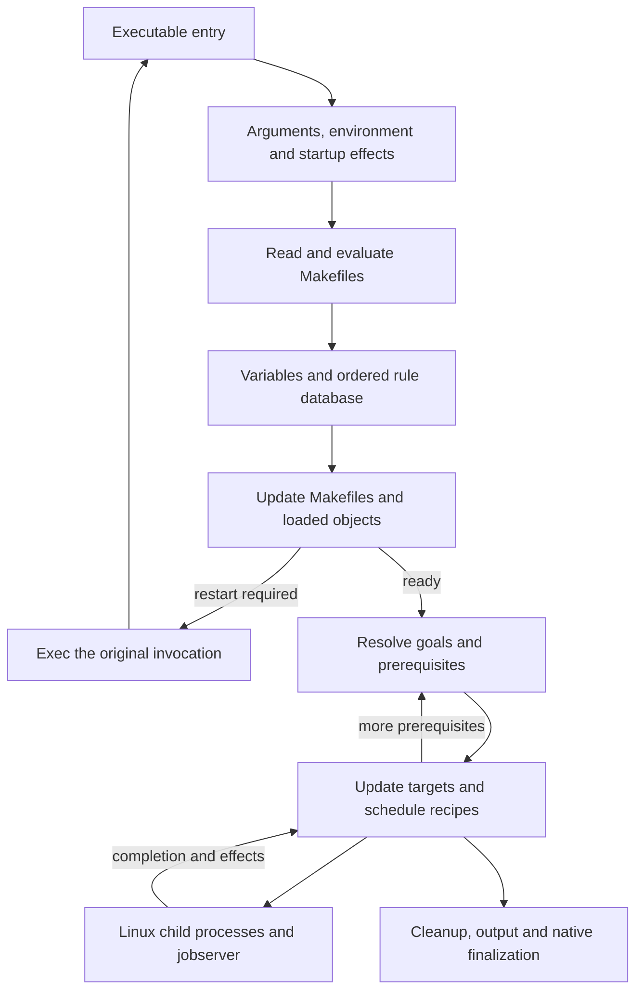

# rmake architecture

rmake is an ordered Makefile interpreter with dependency resolution and a Linux
execution runtime. Evaluation order, variable scope and external effects are
part of its behavior. Changes to storage or scheduling must preserve them.

The [compatibility contract](compatibility.md)
defines required behavior. The [implementation plan](implementation-plan.md) and
[remaining compatibility work](m3-m6-audit.md) describe acceptance criteria and
open work.

## Code layout

The [Cargo workspace](../Cargo.toml) contains four crates. Most subsystems remain
modules within these crates. Create another crate when it gives a useful
ownership, dependency or safety boundary.

| Location | Responsibility |
| --- | --- |
| [`rmake`](../crates/rmake/src/main.rs) | Thin executable entry. Initializes the process locale and enters the application. The optional Guile build also enters the reviewed foreign-runtime host here. |
| [`rmake-app`](../crates/rmake-app/src/lib.rs) | Application lifecycle, CLI startup, dependency traversal, target updates, recipe scheduling and compatibility output. Connects the core interpreter to Linux effects. |
| [`rmake-core`](../crates/rmake-core/src/lib.rs) | Byte-oriented reading, parsing, variable expansion, rule data, implicit-rule helpers and diagnostic formatting. Uses explicit callbacks for external effects. |
| [`rmake-linux`](../crates/rmake-linux/src/lib.rs) | Filesystem and process operations, descriptors, child readiness, jobservers, signals, output transport, locales and native/Guile adapters. |

The conformance tools live in [`tools/`](../tools/) with original inputs in
[`tests/`](../tests/). They are independent Python programs that compare
executables. Expected results come from authored assertions and verified GNU
observations. They must remain independent of the candidate interpreter's
internal model. See the [testing guide](testing.md).

The core and application crates forbid unsafe Rust. Linux adapters contain
reviewed unsafe Rust and C where the operating-system or foreign-function
interface requires it. The executable has a narrow reviewed Guile entry point.
Ownership and lifetime tests protect these boundaries. The workspace pins its
[toolchain](../rust-toolchain.toml) and [dependency lockfile](../Cargo.lock).

## Runtime flow

[`rmake_app::run`](../crates/rmake-app/src/lib.rs) establishes output and signal
ownership, prepares the invocation, then creates and runs
[`Engine`](../crates/rmake-app/src/engine.rs). The engine keeps the rule database,
filesystem observations, target contexts, pending work, child records and
jobserver permits for that invocation. Startup and live option handling remain
part of the same ordered evaluator.

The reader evaluates Makefile statements as it encounters them. Immediate
expansion can affect how a line is classified. Includes and `eval` can introduce
more input while parsing is in progress. Prerequisites can undergo another
expansion later in the selected target's context. See GNU's
[Makefile parsing](https://www.gnu.org/software/make/manual/html_node/Parsing-Makefiles.html)
and [secondary expansion](https://www.gnu.org/software/make/manual/html_node/Secondary-Expansion.html).

After reading, the engine checks whether Makefiles or loaded objects need
updating. A required restart executes the original invocation through the
[initial invocation plan](../crates/rmake-app/src/engine/initial.rs). This preserves
process-entry behavior, module lifetime and startup replay. Reading a whole file
into a fixed syntax tree or restoring only a saved dependency graph would need
to preserve all these phases before it could replace the current flow.

## Where to make changes

| Area | Main code and behavior to preserve |
| --- | --- |
| Startup and options | [`cli.rs`](../crates/rmake-app/src/cli.rs), [`engine/startup.rs`](../crates/rmake-app/src/engine/startup.rs), [`initial.rs`](../crates/rmake-app/src/engine/initial.rs) and [`runtime_options.rs`](../crates/rmake-app/src/engine/runtime_options.rs). Preserve argument order, inherited flags, early effects, directory changes and restart state. |
| Source reading and parsing | [`reader.rs`](../crates/rmake-core/src/reader.rs), [`reader/stream.rs`](../crates/rmake-core/src/reader/stream.rs) and [`parser.rs`](../crates/rmake-core/src/parser.rs). Preserve live source reads, physical/logical line locations, continuations, comments, conditionals, includes, `define`, `eval` and recipe-prefix state. Recipes retain their unexpanded bytes. |
| Variables and expansion | [`variables.rs`](../crates/rmake-core/src/variables.rs) and its [evaluator modules](../crates/rmake-core/src/variables/). Preserve flavor, origin, export policy, definition locations, binding lifetime and global, environment, command-line, lexical, target, pattern and automatic-variable scopes. Lazy arguments retain their evaluation timing. |
| Rules and dependency resolution | [`parser::Database`](../crates/rmake-core/src/parser.rs), [`implicit.rs`](../crates/rmake-core/src/implicit.rs) and [`Engine`](../crates/rmake-app/src/engine.rs). Preserve declaration order, implicit-rule priority, VPATH/GPATH, archives, secondary expansion, intermediate files and scoped automatic variables. Keep declarations distinct from target update state. |
| Recipe behavior | [`recipe_flow.rs`](../crates/rmake-app/src/recipe_flow.rs), [`process.rs`](../crates/rmake-app/src/process.rs), [`oneshell.rs`](../crates/rmake-app/src/oneshell.rs) and the engine. Preserve recipe modifiers, execution modes, shell selection, command arguments, failure handling and target cleanup. |
| Filesystem observations | [`filesystem.rs`](../crates/rmake-linux/src/filesystem.rs), [`archive.rs`](../crates/rmake-linux/src/archive.rs) and [`timestamp.rs`](../crates/rmake-linux/src/timestamp.rs). Preserve the timing of observations, raw path bytes, symlink behavior, stream errors and timestamp decisions. |
| Diagnostics and output | [`diagnostic.rs`](../crates/rmake-core/src/diagnostic.rs), [`database.rs`](../crates/rmake-core/src/database.rs), [`debug.rs`](../crates/rmake-app/src/debug.rs) and [`output.rs`](../crates/rmake-app/src/output.rs). Preserve byte output, source context, event order, synchronization and GNU database/debug presentation. |
| GNU extension calls | The [application native registry](../crates/rmake-app/src/native.rs) and [Linux native adapter](../crates/rmake-linux/src/native.rs). Preserve registration order, argument policy, allocator ownership, callback context and module lifetime. The [optional Guile frontend](guile-frontend.md) uses the same interpreter. |

Names, paths and values are byte strings. Code must preserve non-UTF-8 data.
Source locations distinguish physical input lines from expanded text. Storage
choices must preserve visible order in rules, variables, traversal and diagnostics.
Record visible order explicitly and implement the required compatibility
ordering independently of Rust map iteration. Interning, arena IDs and compact storage remain optimization
choices that require measurements and matching behavior.

The graph can contain cycles, rule groups and prerequisites discovered during
resolution. A shared prerequisite inherits the context of the target that first
causes its update. Preserve that ownership when later targets encounter it.
Duplicate prerequisite occurrences and their normal/order-only roles can remain
visible through automatic variables. GNU documents the relevant
[target-specific variable](https://www.gnu.org/software/make/manual/html_node/Target_002dspecific.html)
and [implicit search](https://www.gnu.org/software/make/manual/html_node/Implicit-Rule-Search.html)
rules.

## Effects and process ownership

An effect includes a filesystem observation, process launch, file write,
diagnostic, variable or rule mutation, or native call. The core passes these
operations through explicit [expansion contexts](../crates/rmake-core/src/diagnostic.rs).
Production handlers perform the real operation. Tests can provide controlled
handlers. Recording an operation does not authorize skipping or replaying it.

The application scheduler owns ready order, `.WAIT`, `.NOTPARALLEL`, `-j`, load
limits, keep-going decisions and cancellation. Linux adapters own process and
resource operations. Recipe completion feeds back into target state, where
failure policy, freshness and grouped-target results determine the next action.
Arbitrary expression evaluation must retain its required ordering even when
recipes run in parallel.

The application event loop uses Linux adapters to wait for owned children,
borrowed jobserver readiness and signal notifications. It uses pidfd readiness where available and a bounded
fallback on supported kernels. Signal handlers perform minimal work and wake
the interpreter through an owned pipe. Cleanup runs through normal runtime
state. See [runtime shutdown](runtime-signals.md).

Each child and jobserver permit has an owner through launch failure, completion
and interruption. Both FIFO and pipe jobservers preserve inherited `MAKEFLAGS`,
the implicit job slot, recursive-command detection, token accounting and token
return. Borrowed pipe blocking modes remain unchanged. Mixed GNU/rmake parents,
children and cooperating tools have dedicated tests. See the
[jobserver implementation](jobserver.md) and GNU's
[POSIX protocol](https://www.gnu.org/software/make/manual/html_node/POSIX-Jobserver.html).

Direct execution must preserve GNU's shell-selection and error behavior.
Ordinary recipe lines keep their separate command boundaries. `.ONESHELL` has
its own preparation rules. Environment bytes, working directory, umask, inherited
descriptors, stdin ownership, terminal behavior and output synchronization all
remain observable. Derive signal and cancellation behavior from controlled probes, including
which processes receive signals and when cleanup runs.

The engine shares invocation-local directory observations across expansion
contexts. Successful file-write opens and recipe dispatch completion invalidate
those observations. Other observations have their own freshness rules.
Refreshing more often than GNU can change behavior too. Preserve the required
observation phase when optimizing filesystem access.

Native callbacks run trusted code with the process's permissions. The
[native runtime](native-modules.md) and [Guile frontend](guile-frontend.md) describe
foreign-stack handling, callback ownership and finalization. These boundaries
need their own lifecycle and failure tests.

## Safe caching progression

The persistent cache is planned as an opt-in feature. Within each invocation,
observations follow the engine’s existing freshness rules.

| Candidate layer | Rollout and required validation |
| --- | --- |
| Interning, arenas and ordered indexes | Introduce when allocation/search measurements justify them and all semantic observations remain unchanged. |
| Pure expansion memoization | Start within one invocation. Track complete scope and binding generations, preserve laziness and exclude effects. |
| Source scanning and expression templates | First persistent layer. Hash the exact bytes read and include format/version identity. Context-dependent interpretation still runs. |
| Rule indexes and graph fragments | Start in memory. Preserve rule priority, dynamic context and dependency discovery. |
| Persistent graph fragments | Require broad conformance, complete dependency tracking, validated observations and proof that reuse skips no required effects. |
| Shell results, recipe results and completed targets | Preserve GNU's execution and freshness behavior. Do not reuse them as persistent build results in compatibility mode. |

### Validate every dependency

Even logical-line scanning can depend on interpreter state. Cache source
structure or parameterized fragments only where that dependency is understood.
A reusable parse result must preserve contextual interpretation.

Persistent entries must identify semantic and cache-format versions, exact
source-content digests, the reference profile and all relevant invocation and
scope inputs. Track variable reads and absence, environment bytes, working
directory, include search, binding generations and filesystem observations.
Hash bytes read for interpretation. A path/mtime/size key is insufficient for
Makefile contents.

Validate negative observations too. A missing include, failed rule candidate,
wildcard nonmatch or absent environment variable can change a future result.
Begin with effect-free declarations and fully tracked pure expansions. Defer
opaque effects, dynamic `eval`, target-sensitive expansion and any case with
incomplete dependency tracking. Shell and plugin effects can change state beyond
the known graph. Recompute when the required observations cannot be validated.

### Preserve effects and freshness

Include and loaded-object remaking, restarts and effectful functions keep their
normal evaluation points, call counts and order. This applies to `shell`, `!=`,
`file`, `info`, `warning`, `error` and extension calls. Exported recursive variables
can produce effects each time the child environment is built. Their previous
expanded value cannot stand in for those effects. See GNU's
[shell function](https://www.gnu.org/software/make/manual/html_node/Shell-Function.html)
and [file function](https://www.gnu.org/software/make/manual/html_node/File-Function.html).

Content hashes validate reusable interpreter data. GNU timestamp semantics still
determine target freshness. Recipe effects, symlink changes and Makefile restarts
must invalidate observations at the correct phase. Inotify can provide a hint,
but cannot establish persistent cache validity on its own.

### Keep cache failures recoverable

Store bounded, disposable entries in an owner-private namespace outside the
build tree. Check lengths, indexes, versions and checksums when reading. Cache
data must never be executable. Use immutable entries, temporary writes and atomic
publication. Avoid untrusted cache paths and release locks before calling user
code.

Corruption, eviction, denied permissions, full disks and lock contention must
fall back to ordinary computation without changing normal status or output.
Cache diagnostics belong in an explicitly requested developer mode. Validate
cache-off, cold, warm, invalidated, corrupt and concurrent runs before accepting
a layer. The benefit must exceed validation and initialization costs.

The initial design uses a private local cache for interpreter data. Review the
namespace and invalidation contract before considering automatic enablement. See
the [compatibility contract](compatibility.md#safety-and-performance-boundary).

## Extensibility without changing defaults

Internal interfaces for functions, effects, rule resolution, diagnostics and
execution support maintenance today. Their ordering and ownership rules remain
explicit as modules evolve.

GNU native loading and Guile are compatibility features. Preserve the documented
ABI, allocation ownership, callbacks, source locations, marker-symbol checks and
loaded-object remake lifecycle. See GNU's
[loaded-object API](https://www.gnu.org/software/make/manual/html_node/Loaded-Object-API.html),
the [native runtime](native-modules.md) and the [Guile frontend](guile-frontend.md).

A public rmake plugin platform is planned after compatibility. Prefer a versioned
external protocol or a capability-restricted runtime. Explicit enablement, typed
requests, deterministic ordering, error policy, plugin/configuration identities
and compatibility tests are required before promising a stable interface.
A public Rust binary ABI would need a separate compatibility commitment.

A plugin's claim of purity is insufficient for caching. Eligible operations need
enforced capabilities, deterministic behavior and complete inputs. Opaque native
callbacks invalidate relevant cache eligibility. Default compatibility mode must
remain free of implicit plugin discovery, added syntax and silent GNU-function
overrides. New modes must retain a full test run of the default mode.

## Measure performance

Measure correctness and end-to-end benefit for each optimization. Workloads
include startup, no-op builds, expansion, implicit search, large graphs,
generated includes, recursion, incremental updates and parallel dispatch.
Separate interpreter time from external recipe time.

The measurement plan includes wall and CPU time, peak memory, allocation counts,
syscalls, bytes read and cache size. Reports must state which metrics were
actually collected and include cache-validation costs where relevant.
[Recorded benchmarks](benchmarks/README.md) retain improvements, regressions and
measurement limits.

Compact values, fewer copies, ordered indexes, pure-expression reuse, fewer
lookups and Linux process improvements are candidates for measurement. A useful
microbenchmark must also produce a net gain in the intended build workload while
passing conformance tests. General speedup remains an objective that requires
broader evidence. The [performance criteria](implementation-plan.md#performance-gates)
define the acceptance requirements.
