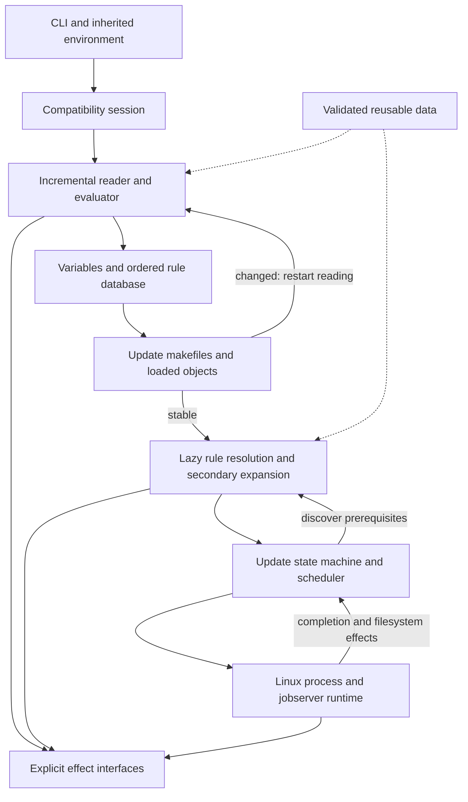

# rmake architecture

Status: proposed design. The governing requirements are in the
[compatibility contract](compatibility.md); delivery gates are in the
[implementation plan](implementation-plan.md).

Build an ordered interpreter with a lazy dependency resolver and a separate Linux
runtime. Optimize its internal representations without changing when Makefile
expressions or external effects occur. A serialized dependency graph is an
optional acceleration structure, never the semantic authority.

## Control flow

This loop matters: generated includes can restart evaluation, and prerequisites
can be expanded in target context later. The documented parser performs immediate
expansion before classifying some lines. Parsing an entire file into a fixed,
context-free AST first would lose that behavior. See
[Makefile parsing](https://www.gnu.org/software/make/manual/html_node/Parsing-Makefiles.html)
and [secondary expansion](https://www.gnu.org/software/make/manual/html_node/Secondary-Expansion.html).

## Workspace boundaries

Start with a small Cargo workspace once implementation begins. Keep most
subsystems as modules; split a crate only when it provides a useful dependency or
safety boundary. No separate service or background daemon is required.

The current workspace contains `rmake-core`, the `rmake` application and
`rmake-linux` for explicit filesystem effects and its private stdio adapter.
Process scheduling still lives in the application; the rest of the boundaries
below describe the intended incremental structure, not completed subsystems.

| Proposed crate | Responsibility | Dependencies |
| --- | --- | --- |
| `rmake-core` | Source handling, expression engine, variables, ordered rules, resolution, update semantics, diagnostic events | No OS process spawning; interfaces for effects |
| `rmake-linux` | Filesystem, shells/processes, descriptors, signals, output transport, jobserver | Core interfaces; a narrow reviewed syscall layer |
| `rmake` | CLI, session configuration, compatibility presentation, integration | Core and Linux runtime |
| `rmake-conformance` | Independent fixtures, oracle execution, comparison, reduction, reports, benchmark driving | Executables as black boxes; no access to core internals for expected answers |

Later add cache storage and GNU extension adapters behind clear boundaries when
their implementation exists. Public rmake plugins come after compatibility. Keep
the conformance runner independent of the core even if some low-level process
utilities can eventually be shared.

Use safe Rust for semantic code. Put necessary unsafe FFI in small audited
adapters with ownership and lifetime tests. Pin the Rust toolchain and dependency
lockfile when Cargo is initialized; select exact versions then. Avoid a general
async framework until measurements demonstrate a need; child-process readiness
and signal handling can use an explicit Linux event loop.

## Interpreter and data model

| Component | Design and invariants |
| --- | --- |
| Source store | Immutable byte buffers, interned names, source spans, physical/logical line mapping. Unix paths and values are not assumed to be UTF-8. |
| Incremental reader | Context-aware logical lines, continuations, comments, conditionals, includes, `define`, recipe-prefix state, and generated input from `eval`. Preserve unexpanded recipe bytes. |
| Expression engine | Explicit immediate, deferred, secondary, recipe, and function-argument contexts. Lazy arguments are evaluated only when required. Track effect order and variable mutations. |
| Variable store | Binding flavor, origin, export policy, definition order, scope and generations. Model global, command-line, environment, target, pattern and automatic-variable contexts explicitly. |
| Function registry | GNU-compatible functions with argument/expansion policy and effect classification. No default registration of rmake-only functions. |
| Rule database | Ordered explicit, static-pattern, implicit, suffix, grouped and double-colon rules. Keep definitions distinct from resolved target instances. |
| Rule resolver | Lazy implicit search, VPATH/GPATH, archives, secondary expansion, intermediate files and scoped automatic variables. Candidate indexes preserve reference priority. |
| Update engine | Explicit target states, ordered prerequisite edges, cycle handling, freshness decisions, grouped outcomes and shared-target ownership. Preserve duplicate/order information where automatic variables expose it. |
| Presentation | Structured semantic events rendered through a GNU-compatible adapter; no default logging mixed into stdout/stderr. Trace/debug/database modes have dedicated formatting. |

Arena-backed IDs and interned byte strings avoid reference cycles and repeated
allocation. Storage layout must not determine visible rule, variable, diagnostic,
or traversal order. Store order explicitly; do not depend on Rust hash-map iteration.

The rule database may contain cycles before resolution and special rule groups;
it is not simply a static DAG. A shared prerequisite also carries the variable
context of the target that actually causes its update. Preserve first-update
ownership and inheritance rather than freely parallelizing evaluation. See
[target-specific variables](https://www.gnu.org/software/make/manual/html_node/Target_002dspecific.html)
and [implicit search](https://www.gnu.org/software/make/manual/html_node/Implicit-Rule-Search.html).

## Effects and Linux execution

Model filesystem observations, subprocess creation, file writes, diagnostics,
variable/rule mutations, and opaque extension calls as explicit operations.
Production handlers perform real effects; tests can supply deterministic handlers.
Recording an effect does not authorize replaying or eliminating it.

Evaluate semantics in a controlled order first. Parallelism initially belongs to
recipe execution, not arbitrary expansion. The scheduler owns ready-order policy,
`.WAIT`, `.NOTPARALLEL`, `-j`, load limits, keep-going decisions and cancellation.
The runtime owns child creation, environment, cwd, umask, descriptors, stdin,
shell invocation, output collection and reaping. This boundary allows optimization
without confusing a process-completion event with a target's semantic success.

Use Linux process primitives where they measurably help, with capability fallbacks
on supported kernels. An optimization such as direct exec must preserve GNU's
shell-selection and error semantics; never combine ordinary recipe lines into one
shell or replace a configured shell with a preferred one. Test `.ONESHELL`
separately. Keep signal handlers minimal and route cleanup through normal runtime
state. Token leases and child ownership must survive spawn failures and interrupts.

Implement both FIFO and pipe jobserver protocols, inherited `MAKEFLAGS`, implicit
slot ownership, recursive-command detection, token accounting, and exact token
return. Do not change inherited pipe blocking modes. Test GNU parent/rmake child,
rmake parent/GNU child, and original cooperating-tool fixtures. The public
[jobserver protocol](https://www.gnu.org/software/make/manual/html_node/POSIX-Jobserver.html)
defines interoperability independently of GNU's implementation.

Preserve output-sync grouping, terminal behavior and stdin ownership. A faster
dispatcher cannot reorder observable parse-time effects or discard GNU's failure
and target-cleanup rules. Cancellation does not mean blindly killing arbitrary
process groups: derive the exact process/signal behavior from controlled probes.

## Safe caching progression

| Layer | Rollout | Required validation |
| --- | --- | --- |
| Interning, arenas, ordered indexes | From first implementation | Same semantic output; allocation and search benchmarks |
| Pure expansion memoization | Within an invocation first | Full scope/binding generations; no effects; lazy evaluation unchanged |
| Source scanning/expression templates | First persistent layer | Hash exact bytes read, format/version identity, contextual interpretation still runs |
| Rule indexes and graph fragments | In-memory first | Rule priority, dynamic context and dependency discovery remain correct |
| Persistent graph fragments | After broad conformance | Explicit purity and dependency proof, complete observation validation, no skipped effects |
| Shell results, recipe results, completed-target state | Not reused in compatibility mode | GNU requires their normal execution/freshness behavior |

Even logical-line scanning depends on context in some constructs. Cache raw-source
structure or parameterized fragments only where the reader can prove independence
from state. Do not treat an ordinary per-file AST as a reusable semantic result.

Persistent entries use semantic/cache-format versions, exact source-content
digests, reference profile, and the complete relevant invocation/scope inputs.
Track variable reads and absence, environment bytes, cwd/include search, definition
generations, and the filesystem observations that informed reuse. Hash bytes already
read for interpretation; do not trust a path/mtime/size key for Makefile contents.
Validate negative observations too: a previously missing include, failed rule
candidate, wildcard nonmatch, or absent environment variable can change the answer.

Graph-fragment eligibility is conservative. Start with effect-free declarations
and fully tracked pure expansions. Defer opaque effects, dynamic `eval`, target
context-sensitive expansion, and any case where dependency tracking is incomplete.
An opaque shell/plugin effect can invalidate observations beyond the known graph;
recompute rather than inventing a directory-based heuristic. Validation must cost
less than reconstruction to justify a hit.

Always preserve include/loaded-object remaking and restart passes. Execute
`shell`, `!=`, `file`, `info`, `warning`, `error`, and extension effects at their
normal evaluation points, with the same call counts and order. Reusing the final
value of an exported recursive variable can wrongly eliminate effects during
environment construction. See [shell expansion](https://www.gnu.org/software/make/manual/html_node/Shell-Function.html)
and [file effects](https://www.gnu.org/software/make/manual/html_node/File-Function.html).

Content hashing validates reusable interpreter data; target freshness still uses
GNU's timestamp semantics. Recipe effects, symlink changes and makefile restarts
must invalidate observations at the correct phase. Refreshing filesystem state
more frequently than GNU can itself change behavior; probe timing rather than
assuming that more freshness is automatically more compatible. Inotify can be an
acceleration hint but cannot establish persistent cache validity by itself.

Store bounded, disposable entries outside the build tree in an owner-private
namespace. Validate lengths, indexes, versions and checksums on read; never load
executable cache data. Use immutable entries, temporary writes and atomic publish;
do not follow untrusted cache paths or hold locks while invoking user code.
Corruption, eviction, permission failures, full disks and lock contention fall
back to ordinary computation without changing normal build status or output.
Cache diagnostics belong only in an explicitly requested developer mode.

Provide cold/warm/off/corrupt/concurrent comparisons before enabling each layer.
No persistent daemon, network cache, or build-output cache in the initial design.
The private-cache namespace and default-off rollout are defined in the
[compatibility contract](compatibility.md#safety-and-performance-boundary).

## Extensibility without changing defaults

Separate three concerns:

1. Internal extension points: function registration, effect handlers, rule
   resolution, diagnostics and execution backends are narrow interfaces with
   explicit ordering and ownership. They support maintenance from the start.
2. GNU compatibility: implement the documented dynamic-load ABI,
   allocator ownership, callbacks, source locations, object-remake lifecycle and
   required marker-symbol checks. Support Guile profiles through a separate
   adapter. Native callbacks remain effectful and trusted code, not a sandbox.
   See the [loaded-object API](https://www.gnu.org/software/make/manual/html_node/Loaded-Object-API.html).
3. Future rmake plugins: stabilize only after conformance. Prefer a versioned
   external protocol or capability-restricted runtime over a public Rust binary
   ABI. Explicit enablement, typed requests, deterministic ordering, error policy,
   plugin/configuration identities and compatibility tests are required.

Plugins never acquire purity simply by declaring it. Only capability-enforced
deterministic operations with complete inputs can participate in memoization.
Opaque/native callbacks invalidate relevant cache eligibility. No implicit plugin
discovery from the current directory, new default syntax, or silent overrides of
GNU functions. New modes retain a full test run of unmodified compatibility mode.

## Performance measurement

Benchmark from milestone 0, then optimize after each feature is correct. Track
startup, no-op builds, macro expansion, implicit search, large graphs, generated
includes, recursive builds, incremental updates and parallel dispatch. Separate
engine time from external recipe time; record wall/CPU time, peak RSS, allocations,
syscalls, bytes read and cache size, including validation overhead.

Candidate optimizations include compact values, less copying, ordered rule
indexes, conservative pure-expression reuse, fewer redundant lookups and cheap
Linux spawning. Each is accepted by measured end-to-end benefit and conformance,
not by microbenchmarks alone. Universal speedups cannot be promised for arbitrary
recipes or tiny workloads. Proposed goals and regression thresholds are in the
[implementation plan](implementation-plan.md#performance-gates).
